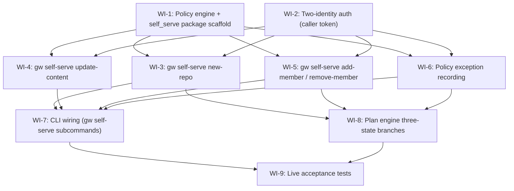

# Work-item dependency graph — INIT-2026-10-11-i3b-self-service

## Parallelism

- **Layer 0** (parallel): WI-1, WI-2
- **Layer 1** (parallel after layer 0): WI-3, WI-4, WI-5, WI-6
- **Layer 2** (parallel after WI-3/4/5/6): WI-7, WI-8
- **Layer 3**: WI-9
