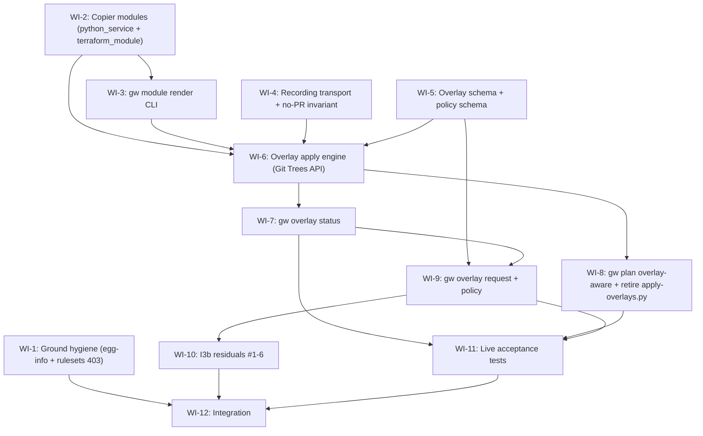

# Work-item dependency graph — INIT-2026-10-17-i4-modules-overlays

## Layer summary

| Layer | WIs | Parallelisable |
|-------|-----|---------------|
| 0 | WI-1, WI-2, WI-4, WI-5 | 4 parallel |
| 1 | WI-3 | after WI-2 |
| 2 | WI-6 | after WI-2, WI-3, WI-4, WI-5 |
| 3 | WI-7, WI-8 | 2 parallel after WI-6 |
| 4 | WI-9 | after WI-7, WI-5 |
| 5 | WI-10, WI-11 | 2 parallel after WI-9 (WI-11 also after WI-8) |
| 6 | WI-12 | after WI-1, WI-10, WI-11 |

## cli.py edit chain

WI-3 adds `module` group → WI-6 adds `overlay` group → WI-7 adds `overlay status` → WI-9 adds `overlay request` → WI-10 updates `list-exceptions --team` optional

Each step depends_on the previous, serialising all cli.py edits. ✓

## overlays.py edit chain

WI-6 creates `gitweave/managers/overlays.py` → WI-7 extends it (WI-7 depends_on WI-6). ✓
