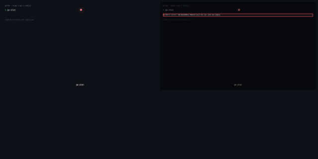
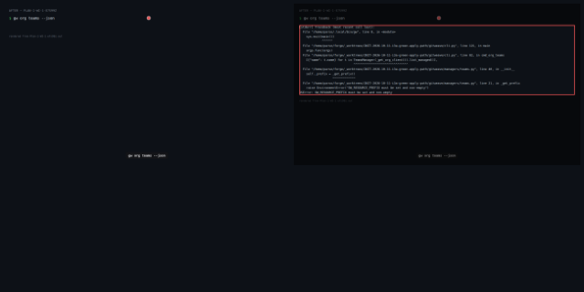
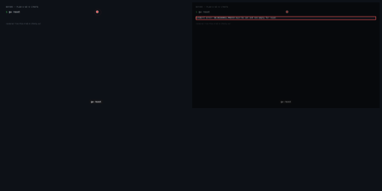
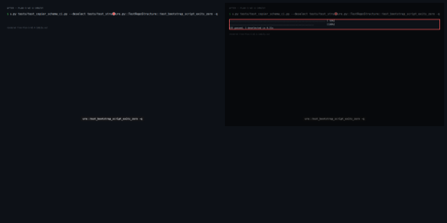
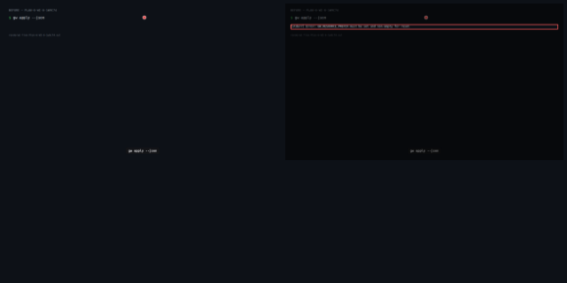
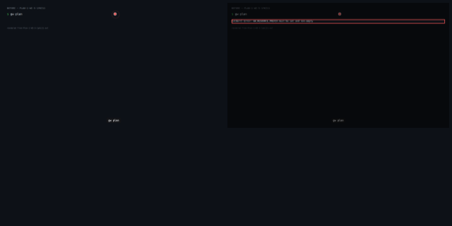
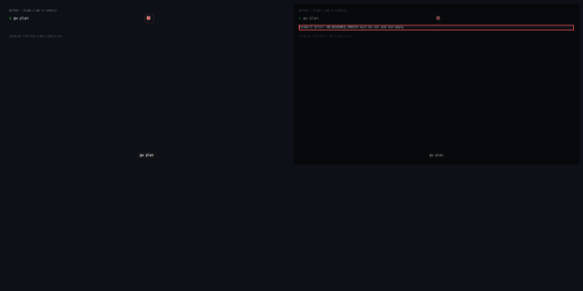
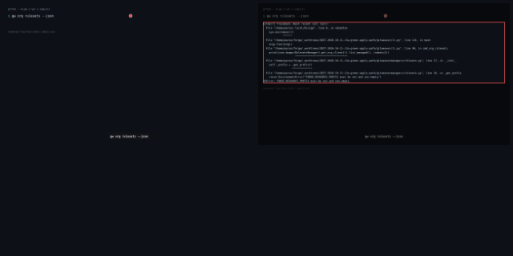
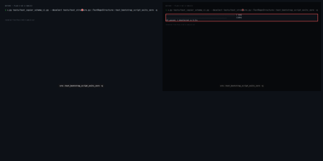

# I3a — Green Apply Path

> _Derived from `demo.json` (D-07). Essence:_ I3a — Green Apply Path — 6 work items delivered against 19 acceptance criteria, 2 merge-boundary gates run. 5 of 11 captured checkpoints changed behaviour. Command output compared after normalising: tap-duration, duration, iso-timestamp, worktree path. API bodies compared as JSON after dropping volatile JSON keys (ids, timestamps, urls, etags, sizes, watchers) and declared ignoreKeys.

## What this enables

_Agent narrative — not evidence._

GitWeave now owns its resource scope with GW_RESOURCE_PREFIX as its primary ownership marker. Operators can run gw plan, apply, and reset using only GitWeave's own env var; FORGE_RESOURCE_PREFIX narrows scope in test-isolation runs but is no longer required. The Apply workflow CI is green, the offline suite passes without ambient forge variables, and live apply is verified credential-free in PRs.

## Summary

- WI-1 [complete] # WI-1: GW_RESOURCE_PREFIX ownership marker
- WI-2 [complete] # WI-2: Fix Apply workflow CI
- WI-3 [complete] # WI-3: Live acceptance — verify apply path with GW_RESOURCE_PREFIX
- WI-4 [complete] # WI-4: Full offline test suite green
- WI-5 [complete] # WI-5 — review-fix concern (code-fix)
- WI-6 [complete] # WI-6 — review-fix concern (code-fix)
- Commit: `93528a00fd8c2dd485df8c27bd7b5f4168aca018`

## Visual Changes

### gw plan scopes by GW_RESOURCE_PREFIX alone (FORGE_RESOURCE_PREFIX absent)

- **Command:** `gw plan`

**Before output:**
```
[stderr] Error: GW_RESOURCE_PREFIX must be set and non-empty
```

**After output:**
```
[stderr] Error: GW_RESOURCE_PREFIX must be set and non-empty
```

[▶ Plan 1: WI-1 — before (webm)](.capture/before/Plan-1-WI-1-1yki11.webm)

[▶ Plan 1: WI-1 — after (webm)](.capture/after/Plan-1-WI-1-1yki11.webm)

### org teams read-back shows only GW_RESOURCE_PREFIX-owned resources

- **Command:** `gw org teams --json`

**Before output:**
```
[stderr] Traceback (most recent call last):
  File "/home/parso/.local/bin/gw", line 8, in <module>
    sys.exit(main())
             ^^^^^^
  File "/home/parso/forge/_worktrees/INIT-2026-10-11-i3a-green-apply-path/gitweave/cli.py", line 121, in main
    args.func(args)
  File "/home/parso/forge/_worktrees/INIT-2026-10-11-i3a-green-apply-path/gitweave/cli.py", line 82, in cmd_org_teams
    [{"name": t.name} for t in TeamsManager(_get_org_client()).list_managed()],
                               ^^^^^^^^^^^^^^^^^^^^^^^^^^^^^^^
  File "/home/parso/forge/_worktrees/INIT-2026-10-11-i3a-green-apply-path/gitweave/managers/teams.py", line 40, in __init__
    self._prefix = _get_prefix()
                   ^^^^^^^^^^^^^
  File "/home/parso/forge/_worktrees/INIT-2026-10-11-i3a-green-apply-path/gitweave/managers/teams.py", line 21, in _get_prefix
    raise EnvironmentError("GW_RESOURCE_PREFIX must be set and non-empty")
OSError: GW_RESOURCE_PREFIX must be set and non-empty
```

**After output:**
```
[stderr] Traceback (most recent call last):
  File "/home/parso/.local/bin/gw", line 8, in <module>
    sys.exit(main())
             ^^^^^^
  File "/home/parso/forge/_worktrees/INIT-2026-10-11-i3a-green-apply-path/gitweave/cli.py", line 121, in main
    args.func(args)
  File "/home/parso/forge/_worktrees/INIT-2026-10-11-i3a-green-apply-path/gitweave/cli.py", line 82, in cmd_org_teams
    [{"name": t.name} for t in TeamsManager(_get_org_client()).list_managed()],
                               ^^^^^^^^^^^^^^^^^^^^^^^^^^^^^^^
  File "/home/parso/forge/_worktrees/INIT-2026-10-11-i3a-green-apply-path/gitweave/managers/teams.py", line 40, in __init__
    self._prefix = _get_prefix()
                   ^^^^^^^^^^^^^
  File "/home/parso/forge/_worktrees/INIT-2026-10-11-i3a-green-apply-path/gitweave/managers/teams.py", line 21, in _get_prefix
    raise EnvironmentError("GW_RESOURCE_PREFIX must be set and non-empty")
OSError: GW_RESOURCE_PREFIX must be set and non-empty
```

[▶ Plan 2: WI-1 — before (webm)](.capture/before/Plan-2-WI-1-e7s99z.webm)

[▶ Plan 2: WI-1 — after (webm)](.capture/after/Plan-2-WI-1-e7s99z.webm)

### org rulesets read-back shows only GW_RESOURCE_PREFIX-owned resources

- **Command:** `gw org rulesets --json`

**Before output:**
```
[stderr] Traceback (most recent call last):
  File "/home/parso/.local/bin/gw", line 8, in <module>
    sys.exit(main())
             ^^^^^^
  File "/home/parso/forge/_worktrees/INIT-2026-10-11-i3a-green-apply-path/gitweave/cli.py", line 121, in main
    args.func(args)
  File "/home/parso/forge/_worktrees/INIT-2026-10-11-i3a-green-apply-path/gitweave/cli.py", line 90, in cmd_org_rulesets
    print(json.dumps(RulesetsManager(_get_org_client()).list_managed(), indent=2))
                     ^^^^^^^^^^^^^^^^^^^^^^^^^^^^^^^^^^
  File "/home/parso/forge/_worktrees/INIT-2026-10-11-i3a-green-apply-path/gitweave/managers/rulesets.py", line 43, in __init__
    self._prefix = _get_prefix()
                   ^^^^^^^^^^^^^
  File "/home/parso/forge/_worktrees/INIT-2026-10-11-i3a-green-apply-path/gitweave/managers/rulesets.py", line 24, in _get_prefix
    raise EnvironmentError("GW_RESOURCE_PREFIX must be set and non-empty")
OSError: GW_RESOURCE_PREFIX must be set and non-empty
```

**After output:**
```
[stderr] Traceback (most recent call last):
  File "/home/parso/.local/bin/gw", line 8, in <module>
    sys.exit(main())
             ^^^^^^
  File "/home/parso/forge/_worktrees/INIT-2026-10-11-i3a-green-apply-path/gitweave/cli.py", line 121, in main
    args.func(args)
  File "/home/parso/forge/_worktrees/INIT-2026-10-11-i3a-green-apply-path/gitweave/cli.py", line 90, in cmd_org_rulesets
    print(json.dumps(RulesetsManager(_get_org_client()).list_managed(), indent=2))
                     ^^^^^^^^^^^^^^^^^^^^^^^^^^^^^^^^^^
  File "/home/parso/forge/_worktrees/INIT-2026-10-11-i3a-green-apply-path/gitweave/managers/rulesets.py", line 43, in __init__
    self._prefix = _get_prefix()
                   ^^^^^^^^^^^^^
  File "/home/parso/forge/_worktrees/INIT-2026-10-11-i3a-green-apply-path/gitweave/managers/rulesets.py", line 24, in _get_prefix
    raise EnvironmentError("GW_RESOURCE_PREFIX must be set and non-empty")
OSError: GW_RESOURCE_PREFIX must be set and non-empty
```

[▶ Plan 3: WI-1 — before (webm)](.capture/before/Plan-3-WI-1-sw6ji0.webm)

[▶ Plan 3: WI-1 — after (webm)](.capture/after/Plan-3-WI-1-sw6ji0.webm)

### gw reset leaves no marker-owned resources in the org

- **Command:** `gw reset`

**Before output:**
```
[stderr] Error: GW_RESOURCE_PREFIX must be set and non-empty for reset
```

**After output:**
```
[stderr] Error: GW_RESOURCE_PREFIX must be set and non-empty for reset
```

[▶ Plan 4: WI-6 — before (webm)](.capture/before/Plan-4-WI-6-17kktq.webm)

[▶ Plan 4: WI-6 — after (webm)](.capture/after/Plan-4-WI-6-17kktq.webm)

### offline suite passes with zero failures and no ambient GW_RESOURCE_PREFIX

- **Command:** `python3 -m pytest tests/test_structure.py tests/test_overlay_schema.py tests/test_copier_schema.py tests/test_copier_schema_ci.py --deselect tests/test_structure.py::TestRepoStructure::test_bootstrap_script_exits_zero -q`

**Before output:**
```
........................................................................ [ 53%]
...............................................................          [100%]
135 passed, 1 deselected in 0.21s

```

**After output:**
```
........................................................................ [ 53%]
...............................................................          [100%]
135 passed, 1 deselected in 0.21s

```

[▶ Plan 5: WI-4 — before (webm)](.capture/before/Plan-5-WI-4-1m8z3y.webm)

[▶ Plan 5: WI-4 — after (webm)](.capture/after/Plan-5-WI-4-1m8z3y.webm)

### apply outputs scoped JSON with GW_RESOURCE_PREFIX; no resources outside marker

- **Command:** `gw apply --json`

**Before output:**
```
[stderr] Error: GW_RESOURCE_PREFIX must be set and non-empty for reset
```

**After output:**
```
[stderr] Error: GW_RESOURCE_PREFIX must be set and non-empty for reset
```

[▶ Plan 6: WI-6 — before (webm)](.capture/before/Plan-6-WI-6-1w9c74.webm)

[▶ Plan 6: WI-6 — after (webm)](.capture/after/Plan-6-WI-6-1w9c74.webm)

### Plan-1-WI-5-1yki11


**Before output:**
```
[stderr] Error: GW_RESOURCE_PREFIX must be set and non-empty
```

**After output:**
```
[stderr] Error: GW_RESOURCE_PREFIX must be set and non-empty
```

[▶ Plan-1-WI-5-1yki11 — before (webm)](.capture/before/Plan-1-WI-5-1yki11.webm)

[▶ Plan-1-WI-5-1yki11 — after (webm)](.capture/after/Plan-1-WI-5-1yki11.webm)

### Plan-2-WI-4-e7s9a2


**Before output:**
```
........................................................................ [ 53%]
...............................................................          [100%]
135 passed, 1 deselected in 0.21s

```

**After output:**
```
........................................................................ [ 53%]
...............................................................          [100%]
135 passed, 1 deselected in 0.21s

```

[▶ Plan-2-WI-4-e7s9a2 — before (webm)](.capture/before/Plan-2-WI-4-e7s9a2.webm)

[▶ Plan-2-WI-4-e7s9a2 — after (webm)](.capture/after/Plan-2-WI-4-e7s9a2.webm)

### Plan-2-WI-5-e7s9a3


**Before output:**
```
[stderr] Error: GW_RESOURCE_PREFIX must be set and non-empty for reset
```

**After output:**
```
[stderr] Error: GW_RESOURCE_PREFIX must be set and non-empty for reset
```

[▶ Plan-2-WI-5-e7s9a3 — before (webm)](.capture/before/Plan-2-WI-5-e7s9a3.webm)

[▶ Plan-2-WI-5-e7s9a3 — after (webm)](.capture/after/Plan-2-WI-5-e7s9a3.webm)

### Plan-3-WI-2-sw6ji1


**Before output:**
```
[stderr] Traceback (most recent call last):
  File "/home/parso/.local/bin/gw", line 8, in <module>
    sys.exit(main())
             ^^^^^^
  File "/home/parso/forge/_worktrees/INIT-2026-10-11-i3a-green-apply-path/gitweave/cli.py", line 121, in main
    args.func(args)
  File "/home/parso/forge/_worktrees/INIT-2026-10-11-i3a-green-apply-path/gitweave/cli.py", line 90, in cmd_org_rulesets
    print(json.dumps(RulesetsManager(_get_org_client()).list_managed(), indent=2))
                     ^^^^^^^^^^^^^^^^^^^^^^^^^^^^^^^^^^
  File "/home/parso/forge/_worktrees/INIT-2026-10-11-i3a-green-apply-path/gitweave/managers/rulesets.py", line 27, in __init__
    self._prefix = _get_prefix()
                   ^^^^^^^^^^^^^
  File "/home/parso/forge/_worktrees/INIT-2026-10-11-i3a-green-apply-path/gitweave/managers/rulesets.py", line 16, in _get_prefix
    raise EnvironmentError("FORGE_RESOURCE_PREFIX must be set and non-empty")
OSError: FORGE_RESOURCE_PREFIX must be set and non-empty
```

**After output:**
```
[stderr] Traceback (most recent call last):
  File "/home/parso/.local/bin/gw", line 8, in <module>
    sys.exit(main())
             ^^^^^^
  File "/home/parso/forge/_worktrees/INIT-2026-10-11-i3a-green-apply-path/gitweave/cli.py", line 121, in main
    args.func(args)
  File "/home/parso/forge/_worktrees/INIT-2026-10-11-i3a-green-apply-path/gitweave/cli.py", line 90, in cmd_org_rulesets
    print(json.dumps(RulesetsManager(_get_org_client()).list_managed(), indent=2))
                     ^^^^^^^^^^^^^^^^^^^^^^^^^^^^^^^^^^
  File "/home/parso/forge/_worktrees/INIT-2026-10-11-i3a-green-apply-path/gitweave/managers/rulesets.py", line 27, in __init__
    self._prefix = _get_prefix()
                   ^^^^^^^^^^^^^
  File "/home/parso/forge/_worktrees/INIT-2026-10-11-i3a-green-apply-path/gitweave/managers/rulesets.py", line 16, in _get_prefix
    raise EnvironmentError("FORGE_RESOURCE_PREFIX must be set and non-empty")
OSError: FORGE_RESOURCE_PREFIX must be set and non-empty
```

[▶ Plan-3-WI-2-sw6ji1 — before (webm)](.capture/before/Plan-3-WI-2-sw6ji1.webm)

[▶ Plan-3-WI-2-sw6ji1 — after (webm)](.capture/after/Plan-3-WI-2-sw6ji1.webm)

### Plan-3-WI-4-sw6ji3


**Before output:**
```
........................................................................ [ 53%]
...............................................................          [100%]
135 passed, 1 deselected in 0.21s

```

**After output:**
```
........................................................................ [ 53%]
...............................................................          [100%]
135 passed, 1 deselected in 0.21s

```

[▶ Plan-3-WI-4-sw6ji3 — before (webm)](.capture/before/Plan-3-WI-4-sw6ji3.webm)

[▶ Plan-3-WI-4-sw6ji3 — after (webm)](.capture/after/Plan-3-WI-4-sw6ji3.webm)

## Test Evidence

| test | result | delta |
|---|---|---|
| local: python3 -m pytest tests/test_structure.py tests/test_overlay_schema.py tests/test_copier_schema.py tests/test_copier_schema_ci.py --deselect tests/test_structure.py::TestRepoStructure::test_bootstrap_script_exits_zero | pass | — |
| ci: python3 -m pytest tests/test_structure.py tests/test_overlay_schema.py tests/test_copier_schema.py tests/test_copier_schema_ci.py | pass | — |

> result: **pass**/**fail** · **skip** = not run in this gate (e.g. a live test with no credentials present) — not a failure · delta **new** = test added by this change.

## Acceptance criteria

- (WI-1) GIVEN GW_RESOURCE_PREFIX is set in the environment and FORGE_RESOURCE_PREFIX is unset WHEN plan() is called in fixture mode THEN resources are scoped to names starting with GW_RESOURCE_PREFIX; plan() completes without EnvironmentError and returns a PlanResult
- (WI-1) GIVEN both GW_RESOURCE_PREFIX and FORGE_RESOURCE_PREFIX are set, where FORGE_RESOURCE_PREFIX starts with GW_RESOURCE_PREFIX WHEN plan() is called in fixture mode THEN only resources matching FORGE_RESOURCE_PREFIX (the narrower prefix) are included; a resource matching GW_RESOURCE_PREFIX but not FORGE_RESOURCE_PREFIX is absent from the result
- (WI-1) GIVEN GW_RESOURCE_PREFIX is unset (empty string) and FORGE_RESOURCE_PREFIX is also unset WHEN plan() is called in fixture mode THEN plan() includes all declared resources (prefix is empty string, so all names start with it)
- (WI-2) GIVEN the gitweave-apply.yaml workflow file after this WI WHEN its dry-run-smoke job (name: 'Apply Configuration') is inspected THEN it does NOT invoke scripts/apply-overlays.py; it either runs gw plan --fixture or is rewired to a gw command, or is removed entirely
- (WI-2) GIVEN the gitweave-apply.yaml workflow file after this WI WHEN the apply job env block is inspected THEN GW_RESOURCE_PREFIX is set (e.g. from secrets.GW_RESOURCE_PREFIX or a static value) so gw apply scopes by the ownership marker
- (WI-2) GIVEN the ci.yaml workflow file after this WI WHEN its job names are listed THEN jobs named exactly 'Structural Tests' and 'Dry-Run Smoke Test' exist and are not renamed
- (WI-3) GIVEN GW_RESOURCE_PREFIX is set and the live org is accessible via GW_APP_ID / GW_APP_INSTALLATION_ID / GW_APP_PRIVATE_KEY_PATH WHEN gw apply runs against the live throwaway org THEN exits 0; only resources whose names start with GW_RESOURCE_PREFIX are touched; the org API is called with valid auth
- (WI-3) GIVEN GW_RESOURCE_PREFIX and FORGE_RESOURCE_PREFIX are both set (forge test-isolation mode) WHEN gw apply runs against the live throwaway org THEN exits 0; only resources matching FORGE_RESOURCE_PREFIX are touched (narrowed scope); no resource outside FORGE_RESOURCE_PREFIX is mutated
- (WI-3) GIVEN the live apply acceptance test has run successfully WHEN gw reset runs with GW_RESOURCE_PREFIX set THEN managed resources created by gw apply are removed; exits 0
- (WI-4) GIVEN WI-1 and WI-2 changes are applied to the repository WHEN python3 -m pytest tests/ runs THEN zero test failures; all offline tests pass or skip; no existing test is regressed
- (WI-5) GIVEN FORGE_RESOURCE_PREFIX explicitly unset in the test process (monkeypatch.delenv or env -u) and GW_RESOURCE_PREFIX set WHEN `gw plan`, `gw apply` and `gw reset` run THEN all three succeed and scope every resource decision by GW_RESOURCE_PREFIX; every manager (teams, repos, rulesets, org) uses GitWeave's marker and none references FORGE_RESOURCE_PREFIX as a requirement
- (WI-5) GIVEN FORGE_RESOURCE_PREFIX is set WHEN any gw command runs THEN it must start with GW_RESOURCE_PREFIX and only narrows the scope; a value that does not start with it is refused by name and nothing is changed
- (WI-5) GIVEN the throwaway org after `gw apply` WHEN `gw reset` runs THEN an API read-back (GET of teams, repos and rulesets) shows no resource carrying the GitWeave marker remains — not exit code alone
- (WI-5) GIVEN the test suite WHEN it is read THEN no autouse fixture sets FORGE_RESOURCE_PREFIX for every test; tests that need it set it explicitly
- (WI-5) GIVEN the PR head WHEN GitHub Actions runs THEN the GitWeave Apply workflow runs on the PR (its path filter covers gitweave/** and the workflow file) and every job, including the live gw apply, is green; Structural Tests and Dry-Run Smoke Test stay green
- (WI-6) GIVEN .github/workflows/gitweave-apply.yaml WHEN its live apply job runs THEN GW_RESOURCE_PREFIX comes from config/org.yaml (read by gw) or a plain workflow value — never a secret — and the "gw apply (live)" job is green on the PR head
- (WI-6) GIVEN the throwaway org after `gw apply` WHEN `gw reset` runs in the live acceptance test THEN GET of the org's teams, repos and rulesets shows no resource carrying the GitWeave marker remains, asserted on the API response, not on exit code or stdout
- (WI-6) GIVEN the live acceptance tests WHEN they check containment THEN containment is asserted on API state (only marker-owned resources were created or changed), not by scraping gw stdout, and org_settings changes are handled as the declared org-level settings they are
- (WI-6) GIVEN the PR head WHEN GitHub Actions runs THEN every job in GitWeave Apply (Apply Configuration, gw plan, gw apply live) plus Structural Tests and Dry-Run Smoke Test is green, and `python3 -m pytest tests/` has zero failures with no ambient GW_RESOURCE_PREFIX

## Files Changed

- `.github/workflows/gitweave-apply.yaml`
- `demo/INIT-2026-10-11-i3a-green-apply-path/.capture/after/Plan-1-WI-1-1yki11.filmstrip.png`
- `demo/INIT-2026-10-11-i3a-green-apply-path/.capture/after/Plan-1-WI-1-1yki11.out`
- `demo/INIT-2026-10-11-i3a-green-apply-path/.capture/after/Plan-1-WI-1-1yki11.png`
- `demo/INIT-2026-10-11-i3a-green-apply-path/.capture/after/Plan-1-WI-1-1yki11.webm`
- `demo/INIT-2026-10-11-i3a-green-apply-path/.capture/after/Plan-1-WI-5-1yki11.filmstrip.png`
- `demo/INIT-2026-10-11-i3a-green-apply-path/.capture/after/Plan-1-WI-5-1yki11.out`
- `demo/INIT-2026-10-11-i3a-green-apply-path/.capture/after/Plan-1-WI-5-1yki11.png`
- `demo/INIT-2026-10-11-i3a-green-apply-path/.capture/after/Plan-1-WI-5-1yki11.webm`
- `demo/INIT-2026-10-11-i3a-green-apply-path/.capture/after/Plan-2-WI-4-e7s9a2.filmstrip.png`
- `demo/INIT-2026-10-11-i3a-green-apply-path/.capture/after/Plan-2-WI-4-e7s9a2.out`
- `demo/INIT-2026-10-11-i3a-green-apply-path/.capture/after/Plan-2-WI-4-e7s9a2.png`
- `demo/INIT-2026-10-11-i3a-green-apply-path/.capture/after/Plan-2-WI-4-e7s9a2.webm`
- `demo/INIT-2026-10-11-i3a-green-apply-path/.capture/after/Plan-2-WI-5-e7s9a3.filmstrip.png`
- `demo/INIT-2026-10-11-i3a-green-apply-path/.capture/after/Plan-2-WI-5-e7s9a3.out`
- `demo/INIT-2026-10-11-i3a-green-apply-path/.capture/after/Plan-2-WI-5-e7s9a3.png`
- `demo/INIT-2026-10-11-i3a-green-apply-path/.capture/after/Plan-2-WI-5-e7s9a3.webm`
- `demo/INIT-2026-10-11-i3a-green-apply-path/.capture/after/Plan-3-WI-2-sw6ji1.filmstrip.png`
- `demo/INIT-2026-10-11-i3a-green-apply-path/.capture/after/Plan-3-WI-2-sw6ji1.out`
- `demo/INIT-2026-10-11-i3a-green-apply-path/.capture/after/Plan-3-WI-2-sw6ji1.png`
- `demo/INIT-2026-10-11-i3a-green-apply-path/.capture/after/Plan-3-WI-2-sw6ji1.webm`
- `demo/INIT-2026-10-11-i3a-green-apply-path/.capture/after/Plan-3-WI-4-sw6ji3.filmstrip.png`
- `demo/INIT-2026-10-11-i3a-green-apply-path/.capture/after/Plan-3-WI-4-sw6ji3.out`
- `demo/INIT-2026-10-11-i3a-green-apply-path/.capture/after/Plan-3-WI-4-sw6ji3.png`
- `demo/INIT-2026-10-11-i3a-green-apply-path/.capture/after/Plan-3-WI-4-sw6ji3.webm`
- `demo/INIT-2026-10-11-i3a-green-apply-path/.capture/before/Plan-1-WI-1-1yki11.filmstrip.png`
- `demo/INIT-2026-10-11-i3a-green-apply-path/.capture/before/Plan-1-WI-1-1yki11.out`
- `demo/INIT-2026-10-11-i3a-green-apply-path/.capture/before/Plan-1-WI-1-1yki11.png`
- `demo/INIT-2026-10-11-i3a-green-apply-path/.capture/before/Plan-1-WI-1-1yki11.webm`
- `demo/INIT-2026-10-11-i3a-green-apply-path/.capture/before/Plan-1-WI-5-1yki11.filmstrip.png`
- `demo/INIT-2026-10-11-i3a-green-apply-path/.capture/before/Plan-1-WI-5-1yki11.out`
- `demo/INIT-2026-10-11-i3a-green-apply-path/.capture/before/Plan-1-WI-5-1yki11.png`
- `demo/INIT-2026-10-11-i3a-green-apply-path/.capture/before/Plan-1-WI-5-1yki11.webm`
- `demo/INIT-2026-10-11-i3a-green-apply-path/.capture/before/Plan-2-WI-4-e7s9a2.filmstrip.png`
- `demo/INIT-2026-10-11-i3a-green-apply-path/.capture/before/Plan-2-WI-4-e7s9a2.out`
- `demo/INIT-2026-10-11-i3a-green-apply-path/.capture/before/Plan-2-WI-4-e7s9a2.png`
- `demo/INIT-2026-10-11-i3a-green-apply-path/.capture/before/Plan-2-WI-4-e7s9a2.webm`
- `demo/INIT-2026-10-11-i3a-green-apply-path/.capture/before/Plan-2-WI-5-e7s9a3.filmstrip.png`
- `demo/INIT-2026-10-11-i3a-green-apply-path/.capture/before/Plan-2-WI-5-e7s9a3.out`
- `demo/INIT-2026-10-11-i3a-green-apply-path/.capture/before/Plan-2-WI-5-e7s9a3.png`
- `demo/INIT-2026-10-11-i3a-green-apply-path/.capture/before/Plan-2-WI-5-e7s9a3.webm`
- `demo/INIT-2026-10-11-i3a-green-apply-path/.capture/before/Plan-3-WI-2-sw6ji1.filmstrip.png`
- `demo/INIT-2026-10-11-i3a-green-apply-path/.capture/before/Plan-3-WI-2-sw6ji1.out`
- `demo/INIT-2026-10-11-i3a-green-apply-path/.capture/before/Plan-3-WI-2-sw6ji1.png`
- `demo/INIT-2026-10-11-i3a-green-apply-path/.capture/before/Plan-3-WI-2-sw6ji1.webm`
- `demo/INIT-2026-10-11-i3a-green-apply-path/.capture/before/Plan-3-WI-4-sw6ji3.filmstrip.png`
- `demo/INIT-2026-10-11-i3a-green-apply-path/.capture/before/Plan-3-WI-4-sw6ji3.out`
- `demo/INIT-2026-10-11-i3a-green-apply-path/.capture/before/Plan-3-WI-4-sw6ji3.png`
- `demo/INIT-2026-10-11-i3a-green-apply-path/.capture/before/Plan-3-WI-4-sw6ji3.webm`
- `demo/INIT-2026-10-11-i3a-green-apply-path/DEMO.md`
- `demo/INIT-2026-10-11-i3a-green-apply-path/demo-plan.json`
- `demo/INIT-2026-10-11-i3a-green-apply-path/demo.json`
- `gitweave.egg-info/SOURCES.txt`
- `gitweave/managers/repos.py`
- `gitweave/managers/rulesets.py`
- `gitweave/managers/teams.py`
- `gitweave/plan.py`
- `gitweave/reset.py`
- `tests/acceptance/test_gw_apply_path.py`
- `tests/acceptance/test_gw_reset_before_apply.py`
- `tests/acceptance/test_gw_workflow.py`
- `tests/conftest.py`
- `tests/test_apply_reset.py`
- `tests/test_apply_workflow_rewired.py`
- `tests/test_apply_workflow_structure.py`
- `tests/test_gw_apply_workflow.py`
- `tests/test_manager_resources.py`
- `tests/test_ownership_marker.py`
- `tests/test_plan.py`

```
69 files changed, 1473 insertions(+), 159 deletions(-)
```
