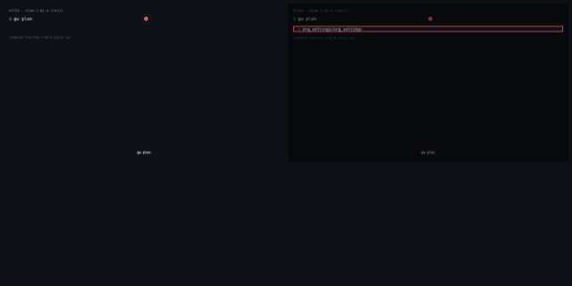
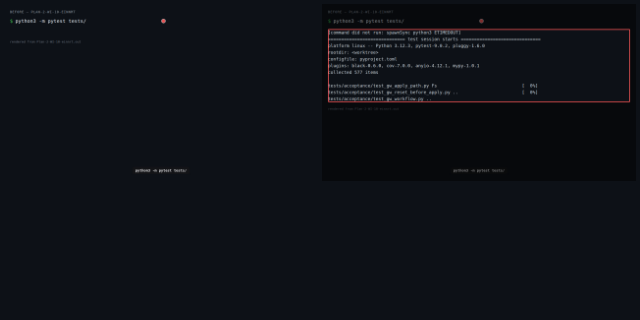
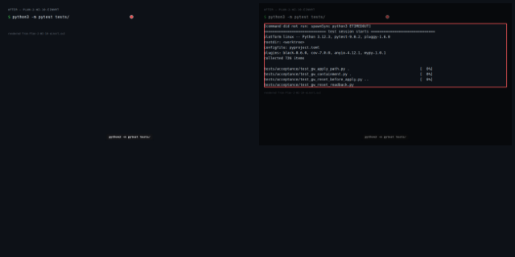
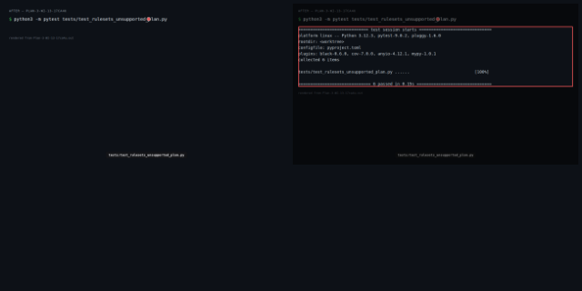
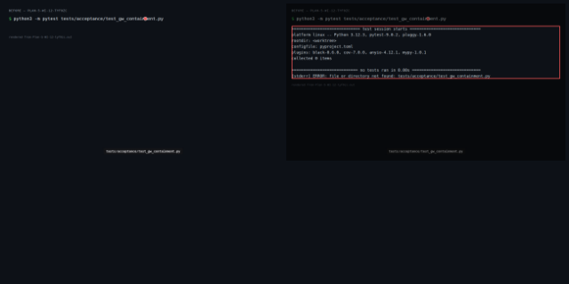

# I3b — Self-Service

> _Derived from `demo.json` (D-07). Essence:_ I3b — Self-Service — 16 work items delivered against 73 acceptance criteria, 2 merge-boundary gates run. 4 of 5 checkpoints changed behaviour. Command output compared after normalising: tap-duration, duration, iso-timestamp, worktree path.

## What this enables

_Agent narrative — not evidence._

Team members can now self-serve GitHub org operations — create repos, update content settings, manage team membership, and record policy exceptions — without operator intervention. Every request is checked against a policy.yaml-declared allowlist; denied requests name the violated rule. The plan engine tracks three action branches (create/unchanged/delete) for all self-serve resource types, closing the delete-branch gap that cost 8 gate runs in I2.

## Summary

- WI-1 [complete] # WI-1: Policy engine + self-serve package scaffold
- WI-2 [complete] # WI-2: Two-identity auth — caller token resolution
- WI-3 [complete] # WI-3: gw self-serve new-repo
- WI-4 [complete] # WI-4: gw self-serve update-content
- WI-5 [complete] # WI-5: gw self-serve add-member / remove-member
- WI-6 [complete] # WI-6: Policy exception recording via GitHub custom properties
- WI-7 [complete] # WI-7: CLI wiring — gw self-serve subcommands
- WI-8 [complete] # WI-8: Plan engine — three state branches for self-serve resource types
- WI-9 [complete] # WI-9: Live acceptance tests — gw self-serve
- WI-10 [complete] # WI-10: Full test suite smoke (AC11 integration gate)
- WI-11 [complete] Reset proven by API read-back after a real create
- WI-12 [complete] Containment proven by API state, not gw stdout
- WI-13 [complete] Rulesets unsupported-plan check is typed, docstring names GitWeave marker
- WI-14 [complete] # WI-14 — review-fix concern (code-fix)
- WI-15 [complete] # WI-15 — review-fix concern (code-fix)
- WI-16 [complete] # WI-16 — review-fix concern (code-fix)
- Commit: `1d6d8dd494f64c9c9ad77093374dc8ecf1502995`

## Visual Changes

### gw plan lists self-serve resource types with all three action branches

- **Command:** `gw plan`

**Before output:**
```
  ~ org_settings/org_settings

```

**After output:**
```
  ~ org_settings/org_settings

```

[▶ Plan 1: WI-8 — before (webm)](.capture/before/Plan-1-WI-8-1yki11.webm)

[▶ Plan 1: WI-8 — after (webm)](.capture/after/Plan-1-WI-8-1yki11.webm)

### Full offline test suite passes — all self-serve, policy and CLI wiring tests green

- **Command:** `python3 -m pytest tests/`

**Before output:**
```
[command did not run: spawnSync python3 ETIMEDOUT]
============================= test session starts ==============================
platform linux -- Python 3.12.3, pytest-9.0.2, pluggy-1.6.0
rootdir: <worktree>
configfile: pyproject.toml
plugins: black-0.6.0, cov-7.0.0, anyio-4.12.1, mypy-1.0.1
collected 577 items

tests/acceptance/test_gw_apply_path.py Fs                                [  0%]
tests/acceptance/test_gw_reset_before_apply.py ..                        [  0%]
tests/acceptance/test_gw_workflow.py ..
```

**After output:**
```
[command did not run: spawnSync python3 ETIMEDOUT]
============================= test session starts ==============================
platform linux -- Python 3.12.3, pytest-9.0.2, pluggy-1.6.0
rootdir: <worktree>
configfile: pyproject.toml
plugins: black-0.6.0, cov-7.0.0, anyio-4.12.1, mypy-1.0.1
collected 726 items

tests/acceptance/test_gw_apply_path.py .                                 [  0%]
tests/acceptance/test_gw_containment.py .                                [  0%]
tests/acceptance/test_gw_reset_before_apply.py ..                        [  0%]
tests/acceptance/test_gw_reset_readback.py 
```

[▶ Plan 2: WI-10 — before (webm)](.capture/before/Plan-2-WI-10-einnrt.webm)

[▶ Plan 2: WI-10 — after (webm)](.capture/after/Plan-2-WI-10-einnrt.webm)

### Rulesets unsupported-plan check: 403 skipped, non-403 propagated, docstring names GW_RESOURCE_PREFIX

- **Command:** `python3 -m pytest tests/test_rulesets_unsupported_plan.py`

**Before output:**
```
============================= test session starts ==============================
platform linux -- Python 3.12.3, pytest-9.0.2, pluggy-1.6.0
rootdir: <worktree>
configfile: pyproject.toml
plugins: black-0.6.0, cov-7.0.0, anyio-4.12.1, mypy-1.0.1
collected 0 items

============================ no tests ran in 0.00s =============================
[stderr] ERROR: file or directory not found: tests/test_rulesets_unsupported_plan.py
```

**After output:**
```
============================= test session starts ==============================
platform linux -- Python 3.12.3, pytest-9.0.2, pluggy-1.6.0
rootdir: <worktree>
configfile: pyproject.toml
plugins: black-0.6.0, cov-7.0.0, anyio-4.12.1, mypy-1.0.1
collected 6 items

tests/test_rulesets_unsupported_plan.py ......                           [100%]

============================== 6 passed in 0.15s ===============================

```

[▶ Plan 3: WI-13 — before (webm)](.capture/before/Plan-3-WI-13-17ca4u.webm)

[▶ Plan 3: WI-13 — after (webm)](.capture/after/Plan-3-WI-13-17ca4u.webm)

### Reset proven by API read-back: resources gone, second run prints Nothing changed

- **Command:** `python3 -m pytest tests/acceptance/test_gw_reset_readback.py`

**Before output:**
```
============================= test session starts ==============================
platform linux -- Python 3.12.3, pytest-9.0.2, pluggy-1.6.0
rootdir: <worktree>
configfile: pyproject.toml
plugins: black-0.6.0, cov-7.0.0, anyio-4.12.1, mypy-1.0.1
collected 0 items

============================ no tests ran in 0.00s =============================
[stderr] ERROR: file or directory not found: tests/acceptance/test_gw_reset_readback.py
```

**After output:**
```
============================= test session starts ==============================
platform linux -- Python 3.12.3, pytest-9.0.2, pluggy-1.6.0
rootdir: <worktree>
configfile: pyproject.toml
plugins: black-0.6.0, cov-7.0.0, anyio-4.12.1, mypy-1.0.1
collected 1 item

tests/acceptance/test_gw_reset_readback.py .                             [100%]

============================== 1 passed in 21.16s ==============================

```

[▶ Plan 4: WI-11 — before (webm)](.capture/before/Plan-4-WI-11-14sjx4.webm)

[▶ Plan 4: WI-11 — after (webm)](.capture/after/Plan-4-WI-11-14sjx4.webm)

### Containment: apply+reset leaves unmarked org resources unchanged, verified by API state not stdout

- **Command:** `python3 -m pytest tests/acceptance/test_gw_containment.py`

**Before output:**
```
============================= test session starts ==============================
platform linux -- Python 3.12.3, pytest-9.0.2, pluggy-1.6.0
rootdir: <worktree>
configfile: pyproject.toml
plugins: black-0.6.0, cov-7.0.0, anyio-4.12.1, mypy-1.0.1
collected 0 items

============================ no tests ran in 0.00s =============================
[stderr] ERROR: file or directory not found: tests/acceptance/test_gw_containment.py
```

**After output:**
```
============================= test session starts ==============================
platform linux -- Python 3.12.3, pytest-9.0.2, pluggy-1.6.0
rootdir: <worktree>
configfile: pyproject.toml
plugins: black-0.6.0, cov-7.0.0, anyio-4.12.1, mypy-1.0.1
collected 1 item

tests/acceptance/test_gw_containment.py .                                [100%]

============================== 1 passed in 15.16s ==============================

```

[▶ Plan 5: WI-12 — before (webm)](.capture/before/Plan-5-WI-12-tyf0zc.webm)

[▶ Plan 5: WI-12 — after (webm)](.capture/after/Plan-5-WI-12-tyf0zc.webm)

## Test Evidence

| test | result | delta |
|---|---|---|
| local: python3 -m pytest tests/test_structure.py tests/test_overlay_schema.py tests/test_copier_schema.py tests/test_copier_schema_ci.py --deselect tests/test_structure.py::TestRepoStructure::test_bootstrap_script_exits_zero | pass | — |
| ci: python3 -m pytest tests/test_structure.py tests/test_overlay_schema.py tests/test_copier_schema.py tests/test_copier_schema_ci.py | pass | — |

> result: **pass**/**fail** · **skip** = not run in this gate (e.g. a live test with no credentials present) — not a failure · delta **new** = test added by this change.

## Acceptance criteria

- (WI-1) GIVEN config/policy.yaml is absent WHEN PolicyLoader.load() is called THEN raises PolicyError with a message naming the missing file; exits non-zero when called via the CLI
- (WI-1) GIVEN config/policy.yaml exists but is not valid YAML WHEN PolicyLoader.load() is called THEN raises PolicyError naming the parse problem; does not silently allow all requests
- (WI-1) GIVEN config/policy.yaml exists but fails jsonschema validation (e.g. missing required field) WHEN PolicyLoader.load() is called THEN raises PolicyError with the schema validation message
- (WI-1) GIVEN a team slug that does not appear in config/policy.yaml WHEN policy.check_permission(team='unknown-team', request_type='new-repo') is called THEN raises PolicyDenied naming the team and stating it has no declared permissions
- (WI-1) GIVEN a team that has 'new-repo' in its allowed_request_types and the repo name matches allowed_patterns WHEN policy.check_permission(team='platform', request_type='new-repo', repo_name='forge-foo') is called THEN returns True without raising
- (WI-1) GIVEN a team that does NOT have the requested request_type in its allowed_request_types WHEN policy.check_permission is called for that type THEN raises PolicyDenied citing the specific rule name (e.g. 'new-repo not in platform.allowed_request_types')
- (WI-1) GIVEN a repo name that does not match the team's allowed_repo_patterns WHEN policy.check_permission(team, 'new-repo', repo_name='not-allowed') is called THEN raises PolicyDenied naming the pattern rule
- (WI-2) GIVEN GW_CALLER_TOKEN is set to a valid token string WHEN get_caller_token() is called THEN returns that token value without invoking gh
- (WI-2) GIVEN GW_CALLER_TOKEN is not set and 'gh auth token' returns a token on stdout WHEN get_caller_token() is called THEN returns the token from gh auth token
- (WI-2) GIVEN GW_CALLER_TOKEN is not set and 'gh auth token' fails (non-zero exit or empty output) WHEN get_caller_token() is called THEN raises CallerTokenRequiredError with a message including 'caller-token-required'; never returns None or an empty string
- (WI-2) GIVEN a valid caller token that the GitHub API /user endpoint can resolve WHEN resolve_caller_login(token) is called (using a mock HTTP client) THEN returns the login string from the API response
- (WI-2) GIVEN a caller token that the GitHub API rejects (401) WHEN resolve_caller_login(token) is called THEN raises CallerTokenRequiredError
- (WI-3) GIVEN policy allows new-repo for the team and name matches the allowed pattern WHEN self_serve_new_repo(team, name, gh_org, policy, caller_login) is called THEN calls gh_org.create_repo with the correct name and returns a success result
- (WI-3) GIVEN same command called when the repo already exists WHEN self_serve_new_repo is called a second time THEN returns success without raising (idempotent — exits 0)
- (WI-3) GIVEN repo name does not match the team's allowed_repo_patterns in policy WHEN self_serve_new_repo is called THEN raises PolicyDenied naming the pattern rule; no API call is made
- (WI-3) GIVEN team not present in policy.yaml WHEN self_serve_new_repo is called THEN raises PolicyDenied naming the team and stating no declared permissions
- (WI-4) GIVEN team policy allows 'content-update' and setting is in team's allowed_content_settings WHEN self_serve_update_content(team, repo_name, setting, value, gh_org, policy, caller_login) is called THEN applies the setting via the appropriate GitHub API call on the repo object and returns success
- (WI-4) GIVEN setting type 'branch_protection' with a rule dict WHEN update_content is called THEN calls repo.get_branch(branch).edit_protection with the provided parameters
- (WI-4) GIVEN setting type 'topics' WHEN update_content is called THEN calls repo.replace_topics with the provided list
- (WI-4) GIVEN setting type not in team's allowed_content_settings in policy WHEN update_content is called THEN raises PolicyDenied naming the setting and the rule
- (WI-4) GIVEN team not in policy WHEN update_content is called THEN raises PolicyDenied naming the team
- (WI-5) GIVEN team policy allows 'team-membership' and caller_login is a member of the team per the live org (mocked) WHEN self_serve_add_member(team, member_login, gh_org, policy, caller_login) is called THEN calls the team's add_to_members API method and returns success
- (WI-5) GIVEN caller is not a member of the team (mocked membership check returns False) WHEN self_serve_add_member is called THEN raises PolicyDenied stating caller is not a member of the team
- (WI-5) GIVEN team not in policy.yaml WHEN self_serve_add_member is called THEN raises PolicyDenied naming the team and stating no declared permissions
- (WI-5) GIVEN team policy allows 'team-membership' and caller is a team member WHEN self_serve_remove_member(team, member_login, gh_org, policy, caller_login) is called THEN calls the team's remove_from_members API method and returns success
- (WI-6) GIVEN team policy allows 'policy-exception' for the repo and exception_name is in allowed_exceptions WHEN self_serve_add_exception(team, repo_name, exception_name, reason, gh_org, policy, caller_login) is called THEN creates the org-level custom property definition (idempotent) and sets it on the repo; returns success
- (WI-6) GIVEN the org-level custom property definition already exists WHEN self_serve_add_exception is called again THEN does not raise; sets the property on the repo (idempotent on the definition creation step)
- (WI-6) GIVEN a repo with one or more exception custom properties set WHEN self_serve_list_exceptions(repo_name, gh_org) is called THEN returns a list of dicts with exception_name and value read back via the GitHub API
- (WI-6) GIVEN team not in policy or exception type not allowed WHEN self_serve_add_exception is called THEN raises PolicyDenied naming the specific rule
- (WI-7) GIVEN gw self-serve new-repo --team <slug> --name <name> is invoked via argparse WHEN main() parses and dispatches THEN calls self_serve_new_repo with correct arguments and exits 0 on success
- (WI-7) GIVEN gw self-serve update-content --team <slug> --repo <name> --setting topics --value 'a,b' is invoked WHEN main() dispatches THEN calls self_serve_update_content with correct arguments and exits 0
- (WI-7) GIVEN gw self-serve add-member --team <slug> --member <login> is invoked WHEN main() dispatches THEN calls self_serve_add_member with correct arguments and exits 0
- (WI-7) GIVEN gw self-serve add-exception --team <slug> --repo <name> --exception <key> --reason <text> WHEN main() dispatches THEN calls self_serve_add_exception and exits 0
- (WI-7) GIVEN gw self-serve list-exceptions --repo <name> is invoked WHEN main() dispatches THEN calls self_serve_list_exceptions, prints JSON result, exits 0
- (WI-7) GIVEN any self-serve command and CallerTokenRequiredError is raised WHEN main() catches it THEN prints error message to stderr containing 'caller-token-required' and exits non-zero
- (WI-7) GIVEN any self-serve command and PolicyDenied is raised WHEN main() catches it THEN prints the policy denial message to stderr and exits non-zero
- (WI-8) GIVEN a self-serve-managed repo declared in policy.yaml that does not yet exist in the snapshot WHEN _diff() processes the snapshot THEN PlanResult includes a PlanItem(resource_type='self_serve_repo', action='create')
- (WI-8) GIVEN a self-serve-managed repo that exists in both declared policy and the snapshot WHEN _diff() processes the snapshot THEN PlanResult includes a PlanItem(resource_type='self_serve_repo', action='unchanged')
- (WI-8) GIVEN a self-serve-managed repo present in the snapshot but removed from policy.yaml WHEN _diff() processes the snapshot THEN PlanResult includes a PlanItem(resource_type='self_serve_repo', action='delete')
- (WI-8) GIVEN a policy exception (custom property) set on a repo that is no longer in policy.yaml exceptions list WHEN _diff() processes the snapshot THEN PlanResult includes a PlanItem(resource_type='policy_exception', action='delete')
- (WI-8) GIVEN a team membership declared in policy.yaml team membership list but not present in the snapshot WHEN _diff() processes the snapshot THEN PlanResult includes a PlanItem(resource_type='team_membership', action='create')
- (WI-9) GIVEN GW_CALLER_TOKEN set to an org-member token, team with new-repo permission in policy.yaml, name matches allowed pattern WHEN `gw self-serve new-repo --team <slug> --name <name>` runs against the throwaway org THEN repo exists (verified via GET /repos/{org}/{name}), command exits 0, no PR opened on control repo
- (WI-9) GIVEN GW_CALLER_TOKEN set, team has content-update permission, requested setting in allowed set WHEN `gw self-serve update-content --team <slug> --repo <name> --setting topics --value forge,test` runs THEN topics applied (verified via API read-back), exits 0, no PR opened on control repo
- (WI-9) GIVEN GW_CALLER_TOKEN set, requester is a team member per policy WHEN `gw self-serve add-member --team <slug> --member <login>` runs THEN membership applied (verified via GET /orgs/{org}/teams/{slug}/memberships/{login}), exits 0, no PR opened
- (WI-9) GIVEN an allowed policy exception for a managed repository WHEN exception applied then `gw self-serve list-exceptions --repo <name>` runs THEN exception listed (custom property verified via GET /repos/{org}/{repo}/properties/values)
- (WI-9) GIVEN a self-serve request that violates a named policy rule WHEN the self-serve command runs against the live org THEN exits non-zero, output names the specific policy rule, org is unchanged
- (WI-9) GIVEN GW_CALLER_TOKEN is not set and gh auth token is unavailable WHEN any gw self-serve command runs THEN exits non-zero with error containing 'caller-token-required'
- (WI-10) GIVEN the repository on main after I3b merges WHEN `python3 -m pytest tests/` runs THEN zero test failures
- (WI-11) GIVEN the test creates one marker-prefixed team and one marker-prefixed repository in the throwaway org through the GitHub API, with GW_* set WHEN `python3 -m pytest tests/acceptance/test_gw_reset_readback.py` runs `gw reset` twice THEN the first run exits 0, a GET of the org teams and repositories (not gw output) lists neither resource, and the second run exits 0 and prints "Nothing changed."
- (WI-12) GIVEN GW_* set and the throwaway org holds teams, repositories and rulesets whose names do not carry the resource marker WHEN `python3 -m pytest tests/acceptance/test_gw_containment.py` runs `gw apply` then `gw reset` THEN a before/after snapshot of the org taken through the GitHub API shows every unmarked team, repository and ruleset unchanged, and the test never parses gw stdout to decide containment
- (WI-13) GIVEN RulesetsManager calls GET /orgs/{org}/rulesets WHEN `python3 -m pytest tests/test_rulesets_unsupported_plan.py` runs with the request raising (a) a GithubException with status 403 and (b) another exception whose message merely contains "403" THEN (a) list_managed returns [] and apply returns status skipped; (b) the exception propagates; and the list_managed docstring names GW_RESOURCE_PREFIX, not FORGE_RESOURCE_PREFIX
- (WI-14) GIVEN any live acceptance test under tests/acceptance/ and one of its required env vars (GW_APP_ID, GW_APP_PRIVATE_KEY_PATH, GW_APP_INSTALLATION_ID, GW_ORG, GW_CALLER_TOKEN, GW_RESOURCE_PREFIX) unset WHEN python3 -m pytest tests/acceptance is run THEN the test FAILS (or errors) naming the missing variable; no live acceptance test uses skipUnless/skip on credentials, and none is stubbed
- (WI-14) GIVEN GW_APP_*, GW_ORG=dave-parso, GW_CALLER_TOKEN and GW_RESOURCE_PREFIX=gw- set (the gate's requiresEnv) WHEN python3 -m pytest tests/ runs as this work item's gate THEN live tests for all four self-serve request types (new repo, content update, team membership, policy exception), reset proven by API read-back after a real create, and containment checked against API state each PASS against dave-parso; the gate output shows them passed and 0 skipped under tests/acceptance
- (WI-14) GIVEN the live acceptance tests create resources in the org WHEN they name and clean up those resources THEN every name derives from GW_RESOURCE_PREFIX (GitWeave's ownership marker); no test reads FORGE_RESOURCE_PREFIX or falls back to a hardcoded prefix
- (WI-14) GIVEN RulesetsManager.apply() meets a non-403 exception from the API WHEN gw apply runs THEN it returns ResourceStatus(status='error', error=...) (403 still → 'skipped'); tests/test_manager_resources.py::test_rulesets_apply_returns_error_on_exception passes; python3 -m pytest tests/ has 0 failures with GW_* and FORGE_* unset (live tier excluded by its env, not skipped silently)
- (WI-14) GIVEN a caller whose team policy.yaml does not permit the request type, name pattern, or target repo WHEN they run any gw self-serve command through the CLI THEN the CLI path calls check_permission() and refuses citing the policy rule; a permitted team can act only on repos within its declared scope (per-repo authorisation), proven by unit tests on the real CLI path
- (WI-14) GIVEN a fresh install of GitWeave from requirements.txt or pyproject.toml WHEN config/policy.yaml is loaded THEN jsonschema is declared in both requirements.txt and pyproject.toml and schema validation actually runs (a schema-invalid policy is rejected by jsonschema, not by the fallback path), proven by a test
- (WI-15) GIVEN tests/acceptance with GW_CALLER_TOKEN unset (the other GW_* set) WHEN python3 -m pytest tests/acceptance -q THEN the run FAILS naming GW_CALLER_TOKEN; no acceptance test uses skipUnless/skipTest/pytest.mark.skip on credentials
- (WI-15) GIVEN tests/acceptance with GW_RESOURCE_PREFIX unset (the other GW_* set) WHEN python3 -m pytest tests/acceptance -q THEN the run FAILS naming GW_RESOURCE_PREFIX
- (WI-15) GIVEN the gitweave package and the live acceptance tests WHEN searching gitweave/ and tests/acceptance/ for FORGE_RESOURCE_PREFIX or the 'gw-acc-' fallback THEN there is no match: every created resource name derives from GW_RESOURCE_PREFIX only (FORGE_RESOURCE_PREFIX is forge's gate-isolation var, not GitWeave's ownership marker)
- (WI-15) GIVEN a caller whose team policy.yaml does not permit the request type, name pattern or target repo WHEN python3 -m pytest tests/test_cli_check_permission.py -q THEN each gw self-serve CLI subcommand dispatch calls gitweave.policy.check_permission (asserted by spy, not by reimplemented inline checks) and the refusal message cites the denying rule; exit non-zero, nothing written to the org
- (WI-15) GIVEN a fresh install from requirements.txt or pyproject.toml WHEN python3 -m pytest tests/test_policy_jsonschema_required.py -q THEN jsonschema is declared in both files; policy.py imports jsonschema unconditionally (no ImportError fallback / minimal validation path); a schema-invalid policy.yaml is rejected with a ValidationError-derived PolicyError
- (WI-15) GIVEN the gw CLI WHEN python3 -m pytest tests/test_cli_remove_member.py -q THEN `gw self-serve remove-member` (or the documented subcommand name) is registered in the argparse tree and dispatches to self_serve_remove_member through check_permission
- (WI-15) GIVEN a missing or schema-invalid team policy.yaml WHEN python3 -m pytest tests/test_cli_policy_error.py -q THEN every self-serve CLI handler catches PolicyError (not only PolicyDenied) and exits non-zero with a one-line error naming the policy file; no traceback
- (WI-15) GIVEN a policy whose allowed_repo_patterns or allowed_exceptions is absent or empty WHEN python3 -m pytest tests/test_policy_fail_closed.py -q THEN check_permission and the allowed_exceptions guard DENY (fail closed) and name the empty list; nothing is permitted by absence
- (WI-16) GIVEN a team policy whose allowed_repo_patterns does not match the target repo WHEN self_serve update-content and self_serve add-exception run for that repo (python3 -m pytest tests/test_self_serve_repo_scope.py -q -k 'content_update or policy_exception') THEN each calls check_permission with repo_name=<the target repo> (asserted with a spy on check_permission) and is refused with PolicyDenied naming allowed_repo_patterns; a matching repo is allowed
- (WI-16) GIVEN a team policy whose allowed_repo_patterns does not match the target repo WHEN self_serve list-exceptions runs for that repo (python3 -m pytest tests/test_self_serve_repo_scope.py -q -k list_exceptions) THEN list-exceptions calls check_permission(policy, team, 'policy-exception', repo_name=<repo>) before any API read (spy asserted) and is refused with PolicyDenied; the CLI list-exceptions subcommand takes --team
- (WI-16) GIVEN the gitweave package and the live acceptance tests WHEN searching gitweave/ and tests/acceptance/ for the literal 'forge-', 'gw-acc-' or FORGE_RESOURCE_PREFIX (comments included) THEN there is no match: every resource the live tests create is named from GW_RESOURCE_PREFIX only, and the policy the live tests run against allows those prefix-derived names (no 'forge-' literal in test names)
- (WI-16) GIVEN the live acceptance test modules WHEN python3 -m pytest tests/test_acceptance_names_from_prefix.py -q (a static AST test over tests/acceptance/*.py) THEN every repo/team name passed to create_repo, create_team, get_repo, get_team_by_slug or a gw --name/--repo argument in tests/acceptance is an f-string or expression that begins with the GW_RESOURCE_PREFIX value (via _resource_prefix()), or is an explicitly listed pre-existing org fixture; the test fails on any bare string literal name
- (WI-16) GIVEN a policy that denies the target repo by allowed_repo_patterns, the GitHub client stubbed WHEN the REAL CLI dispatch runs in-process — gitweave.cli.main() with sys.argv set to 'self-serve update-content|add-exception|list-exceptions --team <t> --repo <denied repo> ...' (python3 -m pytest tests/test_cli_repo_scope_real_dispatch.py -q); no synthetic subprocess, no direct call to the self_serve function THEN each subcommand exits non-zero with a message naming allowed_repo_patterns, makes no write call on the stubbed client, and check_permission received repo_name=<denied repo>; an allowed repo exits 0
- (WI-16) GIVEN live credentials (GW_* set) and the caller's membership state of the target team captured before the test WHEN python3 -m pytest tests/acceptance/test_gw_self_serve.py -q -k add_member_leaves_no_membership THEN the live add-member test runs gw self-serve add-member, verifies the membership via the API, then in a finally block restores the captured state, and asserts via GET that the membership equals the pre-test state; after the run a read-only org scan shows no team membership or prefixed resource left behind by the suite
- (WI-16) GIVEN the three WI-9 live tests test_new_repo_within_policy, test_update_content_topics, test_add_member_within_policy WHEN each runs its gw self-serve command THEN each calls a helper _assert_no_control_repo_pr that reads the control repo's open pull requests via the API before and after the command and asserts none was opened (the WI-9 'no PR opened on control repo' clause is asserted, not assumed)
- (WI-16) GIVEN a working directory with no config/policy.yaml WHEN python3 -m pytest tests/test_cli_policy_absent_real.py -q, which runs the real CLI ([sys.executable, '-m', 'gitweave.cli', 'self-serve', ...]) as a subprocess in that directory THEN the real gw CLI exits non-zero and stderr names config/policy.yaml; the synthetic 'python -c' stand-in in tests/test_policy.py::test_absent_policy_exits_nonzero is removed or replaced by this real-CLI test

## Files Changed

- `config/policy.yaml`
- `demo/INIT-2026-10-11-i3b-self-service/.capture/after/Plan-1-WI-8-1yki11.filmstrip.png`
- `demo/INIT-2026-10-11-i3b-self-service/.capture/after/Plan-1-WI-8-1yki11.out`
- `demo/INIT-2026-10-11-i3b-self-service/.capture/after/Plan-1-WI-8-1yki11.png`
- `demo/INIT-2026-10-11-i3b-self-service/.capture/after/Plan-1-WI-8-1yki11.webm`
- `demo/INIT-2026-10-11-i3b-self-service/.capture/after/Plan-2-WI-10-einnrt.filmstrip.png`
- `demo/INIT-2026-10-11-i3b-self-service/.capture/after/Plan-2-WI-10-einnrt.out`
- `demo/INIT-2026-10-11-i3b-self-service/.capture/after/Plan-2-WI-10-einnrt.png`
- `demo/INIT-2026-10-11-i3b-self-service/.capture/after/Plan-2-WI-10-einnrt.webm`
- `demo/INIT-2026-10-11-i3b-self-service/.capture/after/Plan-3-WI-13-17ca4u.filmstrip.png`
- `demo/INIT-2026-10-11-i3b-self-service/.capture/after/Plan-3-WI-13-17ca4u.out`
- `demo/INIT-2026-10-11-i3b-self-service/.capture/after/Plan-3-WI-13-17ca4u.png`
- `demo/INIT-2026-10-11-i3b-self-service/.capture/after/Plan-3-WI-13-17ca4u.webm`
- `demo/INIT-2026-10-11-i3b-self-service/.capture/after/Plan-4-WI-11-14sjx4.filmstrip.png`
- `demo/INIT-2026-10-11-i3b-self-service/.capture/after/Plan-4-WI-11-14sjx4.out`
- `demo/INIT-2026-10-11-i3b-self-service/.capture/after/Plan-4-WI-11-14sjx4.png`
- `demo/INIT-2026-10-11-i3b-self-service/.capture/after/Plan-4-WI-11-14sjx4.webm`
- `demo/INIT-2026-10-11-i3b-self-service/.capture/after/Plan-5-WI-12-tyf0zc.filmstrip.png`
- `demo/INIT-2026-10-11-i3b-self-service/.capture/after/Plan-5-WI-12-tyf0zc.out`
- `demo/INIT-2026-10-11-i3b-self-service/.capture/after/Plan-5-WI-12-tyf0zc.png`
- `demo/INIT-2026-10-11-i3b-self-service/.capture/after/Plan-5-WI-12-tyf0zc.webm`
- `demo/INIT-2026-10-11-i3b-self-service/.capture/before/Plan-1-WI-8-1yki11.filmstrip.png`
- `demo/INIT-2026-10-11-i3b-self-service/.capture/before/Plan-1-WI-8-1yki11.out`
- `demo/INIT-2026-10-11-i3b-self-service/.capture/before/Plan-1-WI-8-1yki11.png`
- `demo/INIT-2026-10-11-i3b-self-service/.capture/before/Plan-1-WI-8-1yki11.webm`
- `demo/INIT-2026-10-11-i3b-self-service/.capture/before/Plan-2-WI-10-einnrt.filmstrip.png`
- `demo/INIT-2026-10-11-i3b-self-service/.capture/before/Plan-2-WI-10-einnrt.out`
- `demo/INIT-2026-10-11-i3b-self-service/.capture/before/Plan-2-WI-10-einnrt.png`
- `demo/INIT-2026-10-11-i3b-self-service/.capture/before/Plan-2-WI-10-einnrt.webm`
- `demo/INIT-2026-10-11-i3b-self-service/.capture/before/Plan-3-WI-13-17ca4u.filmstrip.png`
- `demo/INIT-2026-10-11-i3b-self-service/.capture/before/Plan-3-WI-13-17ca4u.out`
- `demo/INIT-2026-10-11-i3b-self-service/.capture/before/Plan-3-WI-13-17ca4u.png`
- `demo/INIT-2026-10-11-i3b-self-service/.capture/before/Plan-3-WI-13-17ca4u.webm`
- `demo/INIT-2026-10-11-i3b-self-service/.capture/before/Plan-4-WI-11-14sjx4.filmstrip.png`
- `demo/INIT-2026-10-11-i3b-self-service/.capture/before/Plan-4-WI-11-14sjx4.out`
- `demo/INIT-2026-10-11-i3b-self-service/.capture/before/Plan-4-WI-11-14sjx4.png`
- `demo/INIT-2026-10-11-i3b-self-service/.capture/before/Plan-4-WI-11-14sjx4.webm`
- `demo/INIT-2026-10-11-i3b-self-service/.capture/before/Plan-5-WI-12-tyf0zc.filmstrip.png`
- `demo/INIT-2026-10-11-i3b-self-service/.capture/before/Plan-5-WI-12-tyf0zc.out`
- `demo/INIT-2026-10-11-i3b-self-service/.capture/before/Plan-5-WI-12-tyf0zc.png`
- `demo/INIT-2026-10-11-i3b-self-service/.capture/before/Plan-5-WI-12-tyf0zc.webm`
- `demo/INIT-2026-10-11-i3b-self-service/DEMO.md`
- `demo/INIT-2026-10-11-i3b-self-service/demo-plan.json`
- `demo/INIT-2026-10-11-i3b-self-service/demo.json`
- `gitweave.egg-info/SOURCES.txt`
- `gitweave/auth.py`
- `gitweave/cli.py`
- `gitweave/config.py`
- `gitweave/managers/repos.py`
- `gitweave/managers/rulesets.py`
- `gitweave/managers/teams.py`
- `gitweave/plan.py`
- `gitweave/policy.py`
- `gitweave/reset.py`
- `gitweave/self_serve/__init__.py`
- `gitweave/self_serve/exceptions.py`
- `gitweave/self_serve/membership.py`
- `gitweave/self_serve/new_repo.py`
- `gitweave/self_serve/update_content.py`
- `pyproject.toml`
- `requirements.txt`
- `tests/acceptance/test_gw_apply_path.py`
- `tests/acceptance/test_gw_containment.py`
- `tests/acceptance/test_gw_reset_before_apply.py`
- `tests/acceptance/test_gw_reset_readback.py`
- `tests/acceptance/test_gw_self_serve.py`
- `tests/acceptance/test_gw_workflow.py`
- `tests/conftest.py`
- `tests/test_acceptance_names_from_prefix.py`
- `tests/test_apply_reset.py`
- `tests/test_caller_auth.py`
- `tests/test_cli_check_permission.py`
- `tests/test_cli_policy_absent_real.py`
- `tests/test_cli_policy_error.py`
- `tests/test_cli_remove_member.py`
- `tests/test_cli_repo_scope_real_dispatch.py`
- `tests/test_cli_self_serve.py`
- `tests/test_config.py`
- `tests/test_gw_teams.py`
- `tests/test_manager_resources.py`
- `tests/test_ownership_marker.py`
- `tests/test_plan_self_serve.py`
- `tests/test_policy.py`
- `tests/test_policy_fail_closed.py`
- `tests/test_policy_jsonschema_required.py`
- `tests/test_rulesets_unsupported_plan.py`
- `tests/test_self_serve_exceptions.py`
- `tests/test_self_serve_membership.py`
- `tests/test_self_serve_new_repo.py`
- `tests/test_self_serve_repo_scope.py`
- `tests/test_self_serve_update_content.py`
- `tests/test_suite_smoke.py`

```
92 files changed, 5516 insertions(+), 308 deletions(-)
```
