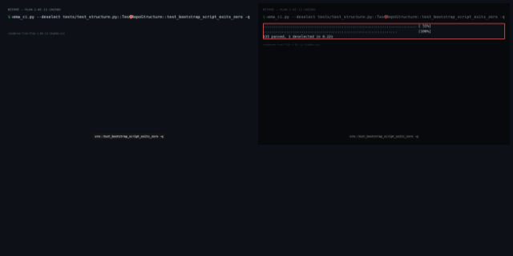
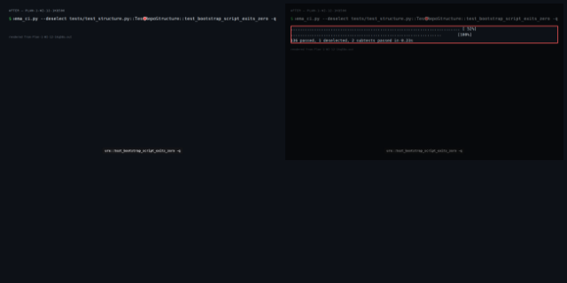
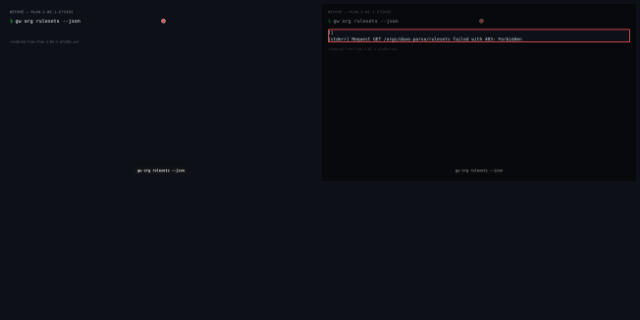
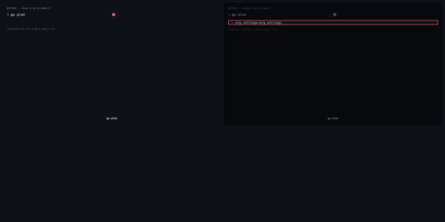
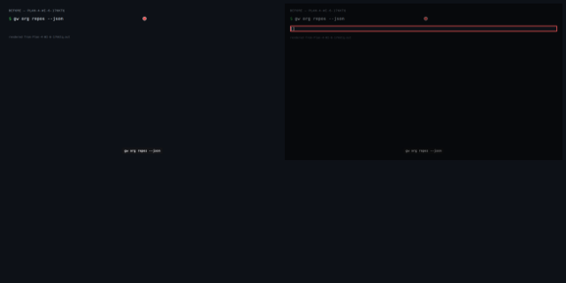

# I4 — Modules that exist, and overlays that apply them

> _Derived from `demo.json` (D-07). Essence:_ I4 — Modules that exist, and overlays that apply them — 17 work items delivered against 65 acceptance criteria, 2 merge-boundary gates run. 1 of 4 checkpoints changed behaviour. Command output compared after normalising: tap-duration, duration, iso-timestamp, worktree path. API bodies compared as JSON after dropping volatile JSON keys (ids, timestamps, urls, etags, sizes, watchers) and declared ignoreKeys.

## What this enables

_Agent narrative — not evidence._

Teams can now declare Copier modules in their repo overlay config and apply them directly to repositories via Git Trees API — no pull request, no manual file copying. The python_service and terraform_module templates render offline, land atomically on the default branch, and record their applied state in per-module answers files. Policy enforcement gates which modules each team may request. The rulesets 403 split, recording transport, and updated plan output complete the foundation for I5's three-way reconcile.

## Summary

- WI-1 [complete] # WI-1: Ground hygiene — egg-info .gitignore + rulesets 403 split
- WI-2a [complete] # WI-2a: Copier modules — python_service module + dependency + config
- WI-2b [complete] # WI-2b: Copier modules — terraform_module
- WI-3 [complete] # WI-3: gw module render CLI subcommand + min_copier_version enforcement
- WI-4 [complete] # WI-4: Recording transport + no-PR invariant (I3b residual #7)
- WI-5 [complete] # WI-5: Overlay schema spec.modules + policy schema allowed_modules
- WI-6 [complete] # WI-6: Overlay apply engine — Git Trees API, 3 state branches
- WI-7 [complete] # WI-7: gw overlay status — read .copier-answers.yml via API
- WI-8 [complete] # WI-8: gw plan overlay-aware + retire scripts/apply-overlays.py
- WI-9 [complete] # WI-9: gw overlay request — self-service + policy enforcement
- WI-10 [complete] # WI-10: I3b residuals #1-6
- WI-11 [complete] # WI-11: Live acceptance tests — overlay apply/status/request
- WI-12 [complete] # WI-12: Integration — all-tests-green
- WI-13 [complete] K1 — Answers-file contract: one record per module at .gitweave/<module>.copier-answers.yml (operator item 1 + item 9 regression). The round-2 plan's single root .copier-answers.yml lets a second module overwrite the first's record; gw apply, gw overlay status and self-serve request all read and write the per-module path, which is I5's merge base. The plan's WI-6/WI-7/WI-8/WI-11 build a single root .copier-answers.yml; K1 migrates their code and tests to the per-module path.
- WI-14 [complete] K2 — Apply-path edges the round-2 plan deferred (operator items 2, 3, 4): an empty repository (no commits) bootstraps and receives the modules (the demo's own path); gw overlay status on a repository with no modules prints 'no modules applied' and exits 0; a push refused by branch protection fails non-zero naming the repository, branch and protection, and never reports success.
- WI-15 [complete] K3 — terraform_module as team content (operator R69 option a) + module directories named by _metadata.name (items 5, 8). GitWeave itself stays Terraform-free: the docs guards scan GitWeave's own docs, README and copilot-context only, never modules/, and still bite on a Terraform token in GitWeave's own docs.
- WI-16 [complete] K4 — Copier as a declared dependency, version-enforced (items 6, 7): copier is declared in pyproject.toml's dependencies with the same spec as requirements.txt, and gw module render refuses a module whose min_copier_version is above the installed Copier, naming both versions (no deferral).
- Commit: `65a1d3189d8e78856e743ba2fe956c28fb5e074b`

## Visual Changes

### Quality gate passes across structure, overlay schema, and copier schema tests

- **Command:** `python3 -m pytest tests/test_structure.py tests/test_overlay_schema.py tests/test_copier_schema.py tests/test_copier_schema_ci.py --deselect tests/test_structure.py::TestRepoStructure::test_bootstrap_script_exits_zero -q`

**Before output:**
```
........................................................................ [ 53%]
...............................................................          [100%]
135 passed, 1 deselected in 0.22s

```

**After output:**
```
........................................................................ [ 52%]
................................................................       [100%]
136 passed, 1 deselected, 2 subtests passed in 0.23s

```

[▶ Plan 1: WI-12 — before (webm)](.capture/before/Plan-1-WI-12-1kq58o.webm)

[▶ Plan 1: WI-12 — after (webm)](.capture/after/Plan-1-WI-12-1kq58o.webm)

### Rulesets field reports unsupported (not a raw 403 error) in org JSON

- **Command:** `gw org rulesets --json`

**Before output:**
```
[]
[stderr] Request GET /orgs/dave-parso/rulesets failed with 403: Forbidden
```

**After output:**
```
[]
[stderr] Request GET /orgs/dave-parso/rulesets failed with 403: Forbidden
```

[▶ Plan 2: WI-1 — before (webm)](.capture/before/Plan-2-WI-1-e7s99z.webm)

[▶ Plan 2: WI-1 — after (webm)](.capture/after/Plan-2-WI-1-e7s99z.webm)

### Plan shows overlay diff — files to add for unmodified repo, unchanged for matched repo

- **Command:** `gw plan`

**Before output:**
```
  ~ org_settings/org_settings

```

**After output:**
```
  ~ org_settings/org_settings

```

[▶ Plan 3: WI-8 — before (webm)](.capture/before/Plan-3-WI-8-sw6ji7.webm)

[▶ Plan 3: WI-8 — after (webm)](.capture/after/Plan-3-WI-8-sw6ji7.webm)

### Org repos list confirms overlay-test repo exists post-apply

- **Command:** `gw org repos --json`

**Before output:**
```
[]

```

**After output:**
```
[]

```

[▶ Plan 4: WI-6 — before (webm)](.capture/before/Plan-4-WI-6-17kktq.webm)

[▶ Plan 4: WI-6 — after (webm)](.capture/after/Plan-4-WI-6-17kktq.webm)

## Test Evidence

| test | result | delta |
|---|---|---|
| local: python3 -m pytest tests/test_structure.py tests/test_overlay_schema.py tests/test_copier_schema.py tests/test_copier_schema_ci.py --deselect tests/test_structure.py::TestRepoStructure::test_bootstrap_script_exits_zero | pass | — |
| ci: python3 -m pytest tests/test_structure.py tests/test_overlay_schema.py tests/test_copier_schema.py tests/test_copier_schema_ci.py | pass | — |

> result: **pass**/**fail** · **skip** = not run in this gate (e.g. a live test with no credentials present) — not a failure · delta **new** = test added by this change.

## Acceptance criteria

- (WI-1) GIVEN the .gitignore file WHEN git ls-files gitweave.egg-info runs THEN it produces no output; git check-ignore gitweave.egg-info/SOURCES.txt exits zero
- (WI-1) GIVEN an org whose plan endpoint returns 403 with a rulesets-unsupported body WHEN gw plan --json runs THEN the rulesets field in JSON output is reported as unsupported with the API error message; exit 0
- (WI-1) GIVEN an org where the 403 indicates a missing token permission (not plan-lacking-rulesets) WHEN gw plan runs THEN gw plan exits non-zero and prints the name of the missing permission
- (WI-1) GIVEN the rulesets manager source code WHEN grep runs over gitweave/managers/rulesets.py THEN no line contains the string '403' inside str(exc) string matching; the two 403 cases are distinguished by response body content or exception type, not string coercion
- (WI-2a) GIVEN modules/python_service/copier.yaml WHEN jsonschema validates it against schemas/copier-module.schema.json THEN validates without errors; has a CalVer version, snake_case name matching directory, and at least one input that changes rendered output
- (WI-2a) GIVEN modules/python_service/.github/workflows/ci.yml.jinja WHEN the rendered CI workflow file is checked with yamllint THEN yamllint exits zero on the rendered output
- (WI-2a) GIVEN pyproject.toml WHEN grep runs for copier in dependencies THEN copier>=9.0 is listed in project.dependencies; requirements.txt pins the same version with a format-stability note comment
- (WI-2a) GIVEN config/repos/example.yaml WHEN it is parsed THEN it references python_service or terraform_module (not example-template); the CI smoke fixture continues to pass
- (WI-2b) GIVEN modules/python_service/copier.yaml and modules/terraform_module/copier.yaml WHEN jsonschema validates each against schemas/copier-module.schema.json THEN both validate without errors; each has a CalVer version, snake_case name matching its directory, and at least one input that changes rendered output
- (WI-2b) GIVEN each module's template directory WHEN the rendered CI workflow file is checked with yamllint THEN yamllint exits zero on the rendered output
- (WI-2b) GIVEN terraform_module has >=1 input declared WHEN test_terraform_module_has_input_that_changes_output runs THEN test passes
- (WI-3) GIVEN a module exists under modules/<name>/ with a valid copier.yaml WHEN gw module render <name> --dest <tmp> runs offline with one non-default input passed via --data key=value THEN the rendered tree under <tmp> contains the module's declared files; the non-default input value appears in the rendered output; exit 0
- (WI-3) GIVEN a module whose copier.yaml declares min_copier_version: '999.0.0' WHEN gw module render <name> --dest <tmp> runs THEN the command exits non-zero and prints a message naming both the required version and the installed version
- (WI-3) GIVEN gw module render produces a rendered CI workflow file WHEN yamllint is run on the rendered file THEN yamllint exits zero
- (WI-3) GIVEN the CLI parser WHEN gw module render --help is called THEN exit 0; the module group and render subcommand are registered in the argparse parser
- (WI-4) GIVEN code that uses RecordingTransport to intercept HTTP calls WHEN the overlay apply path runs (create branch) THEN the recording transport's request log contains zero entries matching POST /repos/*/pulls
- (WI-4) GIVEN a deliberate code mutant that calls POST /repos/{owner}/{repo}/pulls inside the overlay apply path WHEN the recording transport test runs THEN the assertion fails — proving the recording transport catches the violation
- (WI-4) GIVEN both the self-serve code path and the overlay apply code path WHEN they are invoked through the recording transport THEN both paths' HTTP calls are captured in the same request log
- (WI-4) GIVEN GW_CONTROL_REPO is referenced in the codebase WHEN grep runs over gitweave/ THEN no occurrences found; _assert_no_control_repo_pr and GW_CONTROL_REPO are removed
- (WI-5) GIVEN an overlay config with spec.modules: [{name: python_service, version: '2026.10.1', inputs: {service_name: foo}}] WHEN jsonschema validates it against schemas/overlay.schema.json THEN validation passes without errors
- (WI-5) GIVEN config/policy.yaml with per-team allowed_modules: [python_service] and a second team with allowed_modules: [terraform_module] WHEN PolicyLoader().load() runs THEN the loaded policy object exposes per-team allowed_modules; an invalid policy.yaml fails at load time with a schema error
- (WI-5) GIVEN config/policy.yaml is absent WHEN PolicyLoader().load() runs THEN raises a named PolicyError (not FileNotFoundError); the error message names the policy rule
- (WI-5) GIVEN schemas/policy.schema.json is a valid JSON Schema document WHEN jsonschema validates config/policy.yaml against it THEN validation passes
- (WI-6) GIVEN an overlay entry with spec.modules and a repo with no applied modules WHEN gw overlay apply <repo> runs through RecordingTransport THEN the transport log contains: create blob calls, create tree call, create commit call, update ref call; zero POST /repos/*/pulls calls; the rendered files are committed atomically to the default branch
- (WI-6) GIVEN the applied repository where .copier-answers.yml already matches the declared (name, version, inputs) triple WHEN gw overlay apply <repo> runs THEN no new commit is made; the transport log contains no blob/tree/commit/ref write calls
- (WI-6) GIVEN the applied repository where declared inputs differ from .copier-answers.yml (same version, different inputs) WHEN gw overlay apply <repo> runs THEN a new commit appears; .copier-answers.yml content in the commit reflects the new inputs; zero POST /repos/*/pulls
- (WI-6) GIVEN the CLI parser WHEN gw overlay apply --help is called THEN exit 0; the overlay group and apply subcommand are registered
- (WI-7) GIVEN a repository with a .copier-answers.yml recording one applied module WHEN gw overlay status <repo> runs THEN output prints the module's name, version, and inputs, sourced from the repository's .copier-answers.yml via API read-back; exit 0
- (WI-7) GIVEN a repository with no .copier-answers.yml WHEN gw overlay status <repo> runs THEN output prints an informative 'no modules applied' message; exit 0
- (WI-7) GIVEN the CLI parser WHEN gw overlay status --help is called THEN exit 0; the overlay status subcommand is registered
- (WI-8) GIVEN a recorded fixture containing one repo-without-modules entry and one repo-at-declared-version entry WHEN gw plan runs with all GW_* variables unset THEN output lists the module files to add for the repo-without-modules entry; produces no file-change output for the repo-at-declared-version entry; exit 0
- (WI-8) GIVEN scripts/apply-overlays.py exists WHEN git ls-files scripts/apply-overlays.py runs after this WI is delivered THEN the file is not tracked; it has been deleted
- (WI-8) GIVEN the CI dry-run-smoke job in .github/workflows/ WHEN it is inspected THEN it invokes gw plan (not apply-overlays.py); the job still runs credential-free
- (WI-8) GIVEN the offline fixture format WHEN it is documented in tests/test_plan_overlay.py module docstring or a comment THEN the format is described: what keys are present, how repos are represented, how applied-module state is recorded
- (WI-9) GIVEN config/policy.yaml declares python_service allowed for team-a, and team-a owns the target repo WHEN gw overlay request --team team-a --repo target-repo --module python_service runs via RecordingTransport THEN the module is applied with no pull request (transport.assert_no_pr_opens() passes); exit 0
- (WI-9) GIVEN config/policy.yaml declares terraform_module NOT in team-a's allowed_modules WHEN gw overlay request --team team-a --repo target-repo --module terraform_module runs THEN exits non-zero; prints the policy rule name; zero write-call records in the transport log after the refusal
- (WI-9) GIVEN config/policy.yaml is absent WHEN gw overlay request runs THEN exits non-zero with a named policy rule error (not FileNotFoundError); zero write calls
- (WI-9) GIVEN the CLI parser WHEN gw overlay request --help is called THEN exit 0; the overlay request subcommand is registered with --team, --repo, --module arguments
- (WI-10) GIVEN tests/test_cli_check_permission.py enumerates subcommands from the argparse parser WHEN it runs after I4 CLI wiring is complete THEN the test includes gw module render, gw overlay apply, gw overlay status, gw overlay request; a new subcommand without a permission check must fail the test
- (WI-10) GIVEN the add_membership / remove_membership endpoint text in acceptance tests WHEN tests asserting these endpoint names run THEN they pass with the current endpoint names; code is unchanged (documentation only)
- (WI-10) GIVEN the repo-scope idempotency test WHEN the command runs a second time THEN the test asserts zero write calls on the second run; the test also asserts the custom-property value written on the first run
- (WI-10) GIVEN gw self-serve list-exceptions WHEN called without --team THEN lists every team's exceptions; when called with --team, lists one team's exceptions; backward-compatible
- (WI-10) GIVEN the add-member live test WHEN it runs against the throwaway org THEN it starts from a verified absent membership, runs the command, reads membership back as present, then cleans up; a no-op command must fail this test
- (WI-10) GIVEN per-repo CLI tests for update-content, add-member, add-exception WHEN they run THEN they drive the real dispatch path; only the HTTP transport is faked (not entire function patched)
- (WI-10) GIVEN each of the 7 I3b residuals WHEN a no-op mutant of the behaviour is substituted THEN the residual's covering test fails
- (WI-11) GIVEN an overlay entry for a throwaway-org repository that has no applied modules WHEN gw overlay apply runs live (GW_* set) THEN the default branch holds the rendered module files and a .copier-answers.yml (verified via GET /repos/{owner}/{repo}/contents/.copier-answers.yml); transport log contains zero POST /repos/*/pulls; no pull request exists
- (WI-11) GIVEN the applied repository from AC above with the same version and inputs in its overlay entry WHEN gw overlay apply runs live a second time THEN the default-branch HEAD SHA is unchanged (verified via GET /repos/{owner}/{repo})
- (WI-11) GIVEN the applied repository where the overlay entry now specifies different inputs at the same CalVer version WHEN gw overlay apply runs live THEN a new commit appears on the default branch; .copier-answers.yml reflects the new inputs (verified via GET); transport log contains zero POST /repos/*/pulls
- (WI-11) GIVEN the applied repository from AC above WHEN gw overlay status <repo> runs live THEN output prints the module's name, version and inputs sourced from .copier-answers.yml via API read-back
- (WI-11) GIVEN config/policy.yaml declares module M allowed and module N not allowed for a team, and the team owns the target repository WHEN the team requests M via gw overlay request live THEN M is applied with no pull request (transport log confirms zero POST /repos/*/pulls); N is refused with the policy rule name; zero write-call records after the refusal
- (WI-12) GIVEN all GW_* environment variables are unset WHEN python3 -m pytest tests/ (excluding acceptance) runs THEN zero test failures; the full credential-free suite is green
- (WI-12) GIVEN the recording transport test runs across both self-serve and overlay paths WHEN every recorded HTTP request is inspected THEN no request is POST /repos/*/pulls; a deliberate code mutant that opens a pull request causes this assertion to fail
- (WI-12) GIVEN all I4 deliverables are on the branch WHEN python3 -m pytest tests/test_structure.py tests/test_overlay_schema.py tests/test_copier_schema.py tests/test_copier_schema_ci.py --deselect tests/test_structure.py::TestRepoStructure::test_bootstrap_script_exits_zero runs THEN zero failures (the project's primary quality gate is green)
- (WI-13) GIVEN a repository on the recording transport with python_service already applied WHEN gw apply applies terraform_module to the same repository THEN the committed tree holds .gitweave/python_service.copier-answers.yml and .gitweave/terraform_module.copier-answers.yml, no root .copier-answers.yml, and python_service's record is byte-identical to before
- (WI-13) GIVEN a mutant that writes every module's answers to the root .copier-answers.yml WHEN the per-module test runs against the mutant inside the suite (the test's name contains 'root_answers_file_mutant') THEN the mutant run fails the per-module assertion (regression guard for the one-root-file design)
- (WI-13) GIVEN a prefixed throwaway-org repository and an overlay entry listing python_service and terraform_module WHEN gw apply runs live, then gw overlay status <repo> THEN GET contents returns both .gitweave/<module>.copier-answers.yml files and status lists both modules with name, version and inputs; the repository is deleted afterwards
- (WI-14) GIVEN a newly created prefixed throwaway-org repository with no commits WHEN gw apply runs live with an overlay entry for it THEN GET contents on the default branch returns the module's rendered files and its answers file; the repository is deleted afterwards
- (WI-14) GIVEN the recording transport answers the ref lookup with 409 'Git Repository is empty' WHEN gw apply runs, and again with the bootstrap step mutated to a no-op THEN the real run commits the tree; the mutant run fails the test's assertion
- (WI-14) GIVEN a repository with no .gitweave/ directory (contents API 404) WHEN gw overlay status <repo> runs THEN it prints 'no modules applied' and exits 0 with no traceback
- (WI-14) GIVEN the recording transport refuses the ref update with a branch-protection error WHEN gw apply runs THEN it exits non-zero, names the repository, the branch and the protection, and prints no success line for that module
- (WI-15) GIVEN the modules/ tree WHEN each module directory's copier.yaml is read THEN python_service and terraform_module both exist, and every directory name equals its copier.yaml _metadata.name
- (WI-15) GIVEN the narrowed Terraform docs guards WHEN the guard suite runs, including a test that plants a Terraform token in a temporary copy of GitWeave's own docs and one that plants it under modules/ (test names contain 'bite' for the planted-docs case and 'modules' for the modules/ case) THEN the guard flags the planted docs token, ignores modules/, and the real tree passes
- (WI-15) GIVEN terraform_module WHEN gw module render terraform_module --dest <tmp> runs offline with a non-default module_name THEN the rendered main.tf and CI workflow contain that module_name and the CI workflow parses as YAML
- (WI-16) GIVEN pyproject.toml and requirements.txt WHEN their copier entries are compared THEN both declare copier with the same version specifier
- (WI-16) GIVEN a test module whose copier.yaml declares min_copier_version above the installed Copier WHEN gw module render runs on it, and again with the enforcement mutated to a no-op THEN the real run exits non-zero naming the required and installed versions and renders nothing; the mutant run fails the test

## Files Changed

- `.github/workflows/ci.yaml`
- `.gitignore`
- `config/policy.yaml`
- `config/repos/example.yaml`
- `gitweave.egg-info/PKG-INFO`
- `gitweave.egg-info/SOURCES.txt`
- `gitweave.egg-info/dependency_links.txt`
- `gitweave.egg-info/entry_points.txt`
- `gitweave.egg-info/requires.txt`
- `gitweave.egg-info/top_level.txt`
- `gitweave/auth.py`
- `gitweave/cli.py`
- `gitweave/config.py`
- `gitweave/managers/overlays.py`
- `gitweave/managers/rulesets.py`
- `gitweave/module_render.py`
- `gitweave/plan.py`
- `gitweave/policy.py`
- `gitweave/self_serve/exceptions.py`
- `gitweave/self_serve/overlay_request.py`
- `gitweave/transport.py`
- `modules/python_service/.github/workflows/ci.yml.jinja`
- `modules/python_service/copier.yaml`
- `modules/python_service/{{ repo_name }}/.gitkeep`
- `modules/terraform_module/.github/workflows/ci.yml.jinja`
- `modules/terraform_module/copier.yaml`
- `modules/terraform_module/terraform/main.tf.jinja`
- `pyproject.toml`
- `requirements.txt`
- `schemas/policy.schema.json`
- `scripts/apply-overlays.py`
- `tests/acceptance/test_gw_overlay.py`
- `tests/acceptance/test_gw_overlay_empty_repo.py`
- `tests/acceptance/test_gw_overlay_two_modules.py`
- `tests/fixtures/min_ver_fixture/copier.yaml`
- `tests/fixtures/overlay-smoke.json`
- `tests/test_copier_modules.py`
- `tests/test_docs_no_terraform_tokens.py`
- `tests/test_dry_run_ci_workflow.py`
- `tests/test_dry_run_smoke.py`
- `tests/test_i3b_residuals.py`
- `tests/test_i4_integration.py`
- `tests/test_module_min_copier_version.py`
- `tests/test_module_render.py`
- `tests/test_module_terraform_render.py`
- `tests/test_overlay_answers_file_per_module.py`
- `tests/test_overlay_apply.py`
- `tests/test_overlay_empty_repo.py`
- `tests/test_overlay_protected_branch.py`
- `tests/test_overlay_request.py`
- `tests/test_overlay_status.py`
- `tests/test_overlay_status_empty.py`
- `tests/test_plan_overlay.py`
- `tests/test_policy_overlay.py`
- `tests/test_recording_transport.py`
- `tests/test_rulesets_unsupported_plan.py`
- `tests/test_structure.py`

```
57 files changed, 4528 insertions(+), 497 deletions(-)
```
